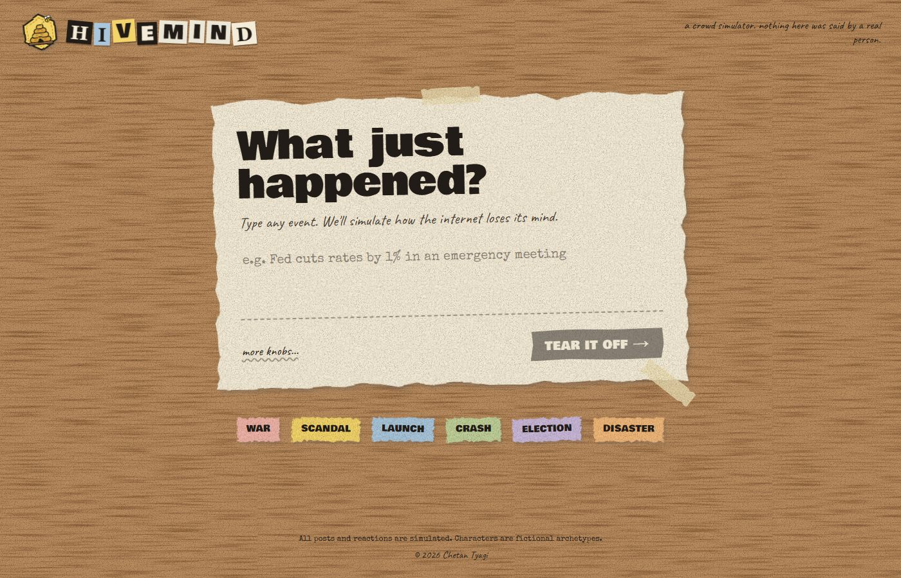
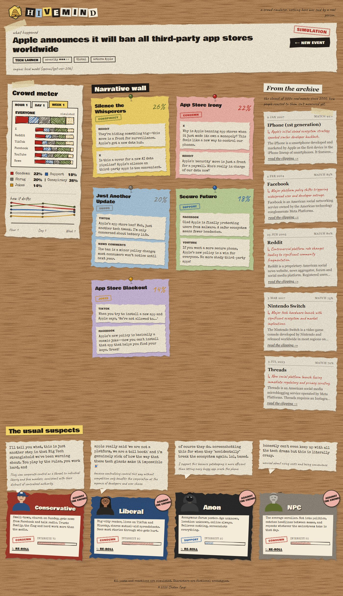

<div align="center">


# HIVEMIND

**Type any event. Watch the internet lose its mind.**

A crowd simulator that predicts how people online would react to a news event: who condemns it, who shrugs, who smells a conspiracy, and how that drifts from the first hour to the first week. All on a stop-motion, cut-paper corkboard.

[**Live demo →**](https://hivemind-chi-drab.vercel.app)




</div>

---

## What you get

Type something like *"Fed cuts rates by 1% in an emergency meeting"* and the board fills in live:

| | |
| --- | --- |
| 📊 **Crowd meter** | Stance split (condemn / support / shrug / conspiracy / jokes) overall and per platform (X, Reddit, TikTok, Facebook, YouTube, news comments), with a drift chart across **hour 1 → day 1 → week 1**. |
| 📌 **Narrative wall** | The 3–6 storylines the crowd forms, each with a share of the conversation and sample posts in each platform's voice. |
| 🗞️ **From the archive** | The closest real events from a library of 300+ since 2000, matched by search and re-ranked by an AI on how similar the *public reaction* would be, with a one-line reason why. |
| 🎭 **The usual suspects** | Four recurring archetypes react in character: **Conservative**, **Liberal**, **Anon** (always against the crowd) and **NPC** (repeats whatever the mainstream says). Re-roll any of them. |

<div align="center">

</div>

> Everything is simulated. No real posts, no real people. Characters are fictional archetypes.

## How it works

```
event text ──► parse (category, actors, severity)
          ├──► archive search: BM25 over 333 Wikidata events ─► AI re-rank top 20
          └──► crowd: hour 1 ─► day 1 ─► week 1   (each phase sees the last)
                                  └──► 4 characters react in parallel
                 all streamed to the board over Server-Sent Events
```

- **Models.** Hosted on the free [Groq](https://groq.com) API: `openai/gpt-oss-20b` for the crowd and `qwen/qwen3.8-27b` for character voices. Locally, it runs fully offline on **Qwen3-0.6B** via llama.cpp (Vulkan, about 400 MB, works on a 4 GB GPU).
- **One LLM layer.** Every call goes through `lib/llm.ts`, which handles Zod-validated JSON output, retries, rate-limit back-off and per-role model choice. Any OpenAI-compatible server or Ollama plugs in.
- **Streaming.** `/api/simulate` emits `meta → parsed → analogs → batch… → phase_done → character → done`, so the board fills in as it thinks. A run takes about 6–35 s.
- **Real archive.** `scripts/build-analogs.mjs` pulls the most widely covered events per category from Wikidata (via [QLever](https://qlever.dev)), ranked by how many Wikipedias cover them.

## The paper look

- **Stop-motion timing.** Easing is quantized to 10 fps (`motion` + GSAP `steps()`).
- **Boiling edges.** A single SVG `feTurbulence` filter, its seed cycled every 120 ms. Only the paper boils, so text stays crisp.
- **Torn edges.** Seeded, jittered `clip-path` polygons, with stacked hard drop-shadows and a ±2° tilt per card.
- **Hand-drawn charts.** [Rough.js](https://roughjs.com), where each fill pattern also encodes a stance.
- **Reduced motion is respected.** The boil stops and entrance tweens are skipped.

## Run it yourself

Requires Node 20+.

```bash
git clone https://github.com/chetanty/hivemind.git
cd hivemind
npm install
```

**Option A: free hosted model (recommended).** Get a key at [console.groq.com](https://console.groq.com) and create `.env.local`:

```env
LLM_BASE_URL=https://api.groq.com/openai/v1
LLM_API_KEY=gsk_...
LLM_MODEL=openai/gpt-oss-20b
LLM_MODEL_CHARACTERS=qwen/qwen3.8-27b
```

```bash
npm run dev   # http://localhost:3000
```

**Option B: fully offline, no key (Windows).**

```bash
npm run llm:setup   # one-time: llama.cpp + Qwen3-0.6B into .local-llm/ (resumable)
npm run llm         # model server on :8080, keep it running
npm run dev         # in another terminal
```

Without any model, the app falls back to template data and says so on the board.

<details>
<summary><b>All environment variables</b></summary>

| Var | Purpose |
| --- | --- |
| `LLM_BASE_URL` | OpenAI-compatible endpoint (default `http://127.0.0.1:8080/v1`) |
| `LLM_API_KEY` | Key for hosted providers |
| `LLM_MODEL` | Crowd and parsing model |
| `LLM_MODEL_CHARACTERS` | Optional separate model for character voices |
| `LLM_PROVIDER` | `llamacpp` (default) or `ollama` |
| `OLLAMA_URL` / `OLLAMA_MODEL` | Only with `LLM_PROVIDER=ollama` |
| `SIM_ENGINE` | `mock` forces template data |

</details>

<details>
<summary><b>API</b></summary>

| Endpoint | Method | Purpose |
| --- | --- | --- |
| `/api/simulate` | POST → SSE | `{ text, region?, horizon?: "hour1" \| "day1" \| "week1", platforms? }` |
| `/api/analogs?q=&rerank=1` | GET | Debug: archive matches for an event |
| `/api/characters` | GET / PUT | List / replace character cards |
| `/api/characters/:id/reroll` | POST | `{ event, crowd? }` → a new reaction |

`/api/simulate` is rate-limited to 10 runs per minute per IP. Types are in `lib/types.ts`.

</details>

<details>
<summary><b>Project layout</b></summary>

```
app/                  Next.js routes + API handlers
components/           PromptDesk, CrowdMeter, NarrativeWall, HistoryDrawer, CharacterRow, Portrait
components/paper/     Paper kit: torn edges, boil filter, tape, pins, stamps, cut letters, Rough.js
hooks/useSimulation   POST + SSE reader + reducer
lib/llm.ts            Provider layer + validated JSON generation
lib/engine/           Engine selector + LLM pipeline
lib/analogs/          Event library (events.json) + BM25 search + AI re-rank
lib/characters/       The four archetypes (edit defaults.ts to change them)
lib/mock/             Template fallback engine
scripts/              build-analogs.mjs, setup-llm.ps1, start-llm.ps1
```

</details>

## Limits and roadmap

The crowd numbers are AI estimates, not measurements. Next up: grounding them in how people actually reacted to the archive events (GDELT, Bluesky), plus a backtest page that scores predictions against real outcomes.

---

<div align="center">
<sub>© 2026 Chetan Tyagi</sub>
</div>
